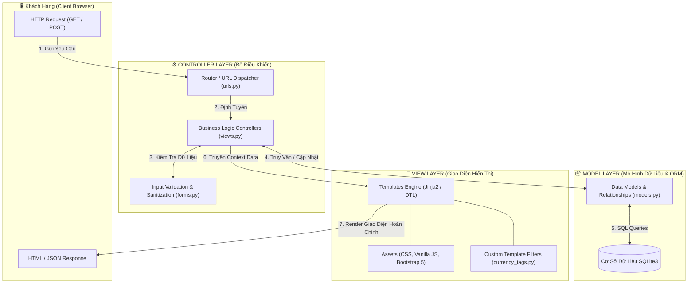

# 👔 FASHIONSTORE — NỀN TẢNG THƯƠNG MẠI ĐIỆN TỬ THỜI TRANG CAO CẤP
### *Đồ Án Chuyên Ngành Phát Triển Ứng Dụng Web Theo Mô Hình Kiến Trúc MVC*

<p align="center">
  
</p>

<p align="center">
  <a href="https://www.python.org/"></a>
  <a href="https://www.djangoproject.com/"></a>
  <a href="https://www.django-rest-framework.org/"></a>
  <a href="https://getbootstrap.com/"></a>
  <a href="https://www.sqlite.org/"></a>
  <a href="LICENSE"></a>
</p>

---

## 📌 1. TỔNG QUAN DỰ ÁN (PROJECT OVERVIEW)

**FashionStore** là hệ thống website thương mại điện tử chuyên ngành thời trang tối giản (Minimalist Fashion) được thiết kế và xây dựng theo chuẩn **mô hình kiến trúc MVC (Model - View - Controller)**. Hệ thống mang lại trải nghiệm mua sắm mượt mà, hỗ trợ quản lý đa biến thể kích cỡ / màu sắc, quy trình đặt hàng nguyên tử an toàn tuyệt đối và bảng điều khiển quản trị số liệu kinh doanh chuyên sâu.

### 🌟 Điểm nổi bật:
- 📱 **Responsive 100% mọi thiết bị:** Tối ưu hóa chuyên biệt cho Desktop, Laptop, iPad và Smartphone với **Mobile Bottom Navigation Bar** tiện dụng như ứng dụng Native.
- ⚡ **Chạy ngay 1-Click (`run.bat`):** Đã tích hợp sẵn toàn bộ dữ liệu mẫu thực tế (70+ sản phẩm, 7 danh mục, ảnh sản phẩm, tài khoản phân quyền) mà không cần cấu hình phức tạp.
- 💰 **Định dạng tiền tệ VNĐ:** Chuẩn hóa toàn bộ giá cả theo phong cách thị trường Việt Nam (`189.000₫`, `1.290.000₫`).
- 🔐 **Popup Modal Auth thông minh:** Trải nghiệm đăng nhập / đăng ký qua popup nhanh không gián đoạn quá trình duyệt web.

---

## 🏛️ 2. MÔ HÌNH KIẾN TRÚC MVC (MODEL - VIEW - CONTROLLER)

Hệ thống được tổ chức phân tầng nghiêm ngặt theo chuẩn **Mô hình MVC**:



### Chi Tiết Phân Phối Trách Nhiệm Trong Mô Hình MVC:

| Thành Phần MVC | Tương Ứng Trong Dự Án | Trách Nhiệm & Vai Trò Cốt Lõi |
| :--- | :--- | :--- |
| **MODEL (M)** | `*/models.py` | Quản lý cấu trúc thực thể, quan hệ bảng (1-n, n-n), quy tắc nghiệp vụ dữ liệu, phương thức tính toán tồn kho (`get_total_stock`), giá ưu đãi (`get_final_price`), ánh xạ ORM an toàn chống SQL Injection. |
| **VIEW (V)** | `templates/` & `static/` | Tầng trình bày giao diện người dùng (Presentation Layer). Tiếp nhận dữ liệu Context từ Controller để kết xuất HTML ngữ nghĩa, định dạng tiền tệ Việt Nam (`|vnd`), CSS giao diện chuẩn Zara/Routine và JavaScript phản hồi tức thì. |
| **CONTROLLER (C)** | `*/views.py`, `*/urls.py`, `*/forms.py` | Tiếp nhận HTTP Request từ Client, điều phối luồng nghiệp vụ (Business Workflow), kiểm tra tính hợp lệ dữ liệu nhập (Validation), thực thi giao dịch nguyên tử (`transaction.atomic`), điều hướng và trả kết quả về View. |

---

## 🚀 3. HƯỚNG DẪN KHỞI CHẠY DỰ ÁN

### Cách 1: Khởi chạy 1-Click (Khuyến nghị cho Windows)
Dự án đã được tích hợp sẵn file thực thi thông minh [`run.bat`](file:///c:/Users/ThinkPad/Downloads/lab8-main/lab8-main/run.bat):
1. Tải source code về máy (hoặc `git clone https://github.com/DuongNeeee207/lab8.git`).
2. Mở thư mục dự án và **nhấp đúp chuột vào file `run.bat`**.
3. Hệ thống sẽ **tự động kiểm tra môi trường, kết nối thư viện và tự bật trình duyệt web** tại:
   👉 **[http://127.0.0.1:8000/](http://127.0.0.1:8000/)**

---

### Cách 2: Khởi chạy thủ công qua Terminal / Command Prompt

```powershell
# 1. Truy cập vào thư mục mã nguồn
cd lab8-main

# 2. Cài đặt các thư viện cần thiết
pip install -r requirements.txt

# 3. Khởi chạy máy chủ phát triển
python manage.py runserver
```

Truy cập website trên trình duyệt: [http://127.0.0.1:8000/](http://127.0.0.1:8000/)

---

## 🔑 4. TÀI KHOẢN HỆ THỐNG CÓ SẴN (DEMO CREDENTIALS)

Cơ sở dữ liệu đã nạp sẵn tài khoản mẫu để bạn kiểm thử phân quyền ngay lập tức:

| Vai Trò | Tên Đăng Nhập (`username`) | Mật Khẩu (`password`) | Quyền Hạn & Chức Năng |
| :--- | :--- | :--- | :--- |
| **Quản trị viên (Admin)** | `admin` | `admin123` | Toàn quyền hệ thống: Bảng điều khiển quản trị (`/management/dashboard/`), Thêm/Sửa/Xóa sản phẩm & danh mục, Quản lý đơn hàng, Django Admin (`/admin/`). |
| **Khách hàng (Customer)** | `khachhang` | `customer123` | Mua sắm, giỏ hàng, đặt hàng COD, theo dõi lịch sử đơn hàng cá nhân (`/orders/history/`), đánh giá sản phẩm. |

---

## 🧩 5. PHÂN RÃ CÁC MODULE CHỨC NĂNG (SYSTEM MODULES)

### 1. Phân Hệ Người Dùng & Phân Quyền (`accounts`)
- **Controller:** Đăng ký tài khoản mới (`register`), Đăng nhập chuẩn hóa (`login`), Đăng xuất an toàn (`logout`), Cập nhật hồ sơ cá nhân (`profile`).
- **Model:** Mở rộng `User` với `Profile` (Địa chỉ giao hàng, số điện thoại, ảnh đại diện).
- **View:** Giao diện tối giản, tích hợp **Popup Modal Auth 2 nút** kích hoạt tự động khi người dùng chưa đăng nhập bấm vào các chức năng thành viên.

### 2. Phân Hệ Danh Mục & Sản Phẩm Đa Biến Thể (`products`)
- **Model:** `Category`, `Product`, `ProductVariant` (lưu trữ kích cỡ S/M/L/XL/XXL/Freesize, màu sắc, mã định danh kho SKU, số lượng tồn kho từng loại).
- **Controller:** Lọc danh mục, tìm kiếm đa tiêu chí (keyword, giá cả, sắp xếp), kiểm tra tồn kho realtime qua AJAX.
- **View:** Bố cục dạng lưới Responsive (2 cột trên mobile, 4 cột trên desktop), nhãn giảm giá, bộ lọc danh mục offcanvas tiện lợi.

### 3. Phân Hệ Giỏ Hàng Thông Minh (`cart`)
- **Controller:** Thêm sản phẩm (`cart_add`), Tăng/giảm số lượng (`cart_update`), Xóa món (`cart_remove`).
- **Nghiệp vụ:** Kiểm tra số lượng thêm vào so với tồn kho thực tế; tự động tính tổng tiền giỏ hàng; hỗ trợ context processor hiển thị số lượng giỏ hàng trên mọi trang.

### 4. Phân Hệ Đặt Hàng & Giao Dịch Nguyên Tử (`orders`)
- **Controller:** `checkout_view`, `order_history`, `order_detail`, `admin_order_list`.
- **Nghiệp vụ Giao Dịch An Toàn (`transaction.atomic`):**
  - Khóa và trừ tồn kho chính xác theo từng biến thể sản phẩm khi đặt hàng.
  - Tự động hoàn lại số lượng tồn kho khi đơn hàng bị Hủy (`Cancelled`).
  - Hỗ trợ phương thức thanh toán khi nhận hàng (COD).

### 5. Phân Hệ Đánh Giá & Phản Hồi (`reviews`)
- Khách hàng đã đăng nhập có thể gửi bình luận và chấm điểm sản phẩm theo thang sao (1 - 5 sao).
- Điểm đánh giá trung bình được tính toán và hiển thị tự động trên thẻ sản phẩm.

### 6. Bảng Điều Khiển Quản Trị Doanh Thu (`core:admin_dashboard`)
- Thống kê tổng doanh thu bán hàng thực tế.
- Báo cáo số lượng đơn theo 4 trạng thái: Chờ xử lý (`Pending`), Đã xác nhận (`Confirmed`), Đang giao (`Shipping`), Hoàn thành (`Delivered`).

---

## 🌐 6. ĐẶC TẢ GIAO DIỆN LẬP TRÌNH REST API (DRF)

Hệ thống cung cấp sẵn các Web API phục vụ mở rộng cho ứng dụng di động hoặc bên thứ ba:

| Endpoint | Phương Thức | Mô Tả Chức Năng | Phân Quyền |
| :--- | :---: | :--- | :--- |
| `/api/categories/` | `GET` | Lấy danh sách toàn bộ danh mục thời trang | Công khai |
| `/api/products/` | `GET` | Lấy danh sách sản phẩm (có phân trang & lọc danh mục) | Công khai |
| `/api/products/<id>/` | `GET` | Xem chi tiết thông tin sản phẩm và các biến thể size/màu | Công khai |
| `/api/products/create/` | `POST` | Thêm mới sản phẩm vào hệ thống | Chỉ Admin |
| `/api/products/<id>/update/`| `PUT / PATCH` | Cập nhật thông tin sản phẩm | Chỉ Admin |
| `/api/products/<id>/delete/`| `DELETE` | Xóa sản phẩm khỏi cơ sở dữ liệu | Chỉ Admin |

---

## 📂 7. CẤU TRÚC THƯ MỤC CHUẨN KIẾN TRÚC MVC

```text
lab8-main/
│
├── accounts/                   # [MVC - Controller & Model] Phân hệ tài khoản
│   ├── models.py               # Model: Profile
│   ├── views.py                # Controller: Login, Register, Profile
│   ├── forms.py                # Controller: Form Validation
│   └── urls.py                 # Router
│
├── products/                   # [MVC - Controller & Model] Phân hệ sản phẩm
│   ├── models.py               # Model: Category, Product, ProductVariant
│   ├── views.py                # Controller: List, Detail, Admin CRUD
│   ├── serializers.py          # REST API Serializers
│   ├── api_views.py            # API Controllers (DRF)
│   └── management/commands/    # Lệnh Seed nạp 70+ sản phẩm thật
│
├── cart/                       # [MVC - Controller & Model] Phân hệ giỏ hàng
│   ├── models.py               # Model: Cart, CartItem
│   └── views.py                # Controller: Add, Update, Remove
│
├── orders/                     # [MVC - Controller & Model] Phân hệ đơn hàng
│   ├── models.py               # Model: Order, OrderItem
│   └── views.py                # Controller: Atomic Checkout, Order Detail
│
├── core/                       # [MVC - Core Utilities & Dashboard]
│   ├── views.py                # Controller: Home, About, Dashboard
│   └── templatetags/           # View Helper: Bộ lọc định dạng VND (vnd)
│
├── templates/                  # [MVC - VIEW LAYER] Giao diện Jinja/DTL
│   ├── base.html               # Layout khung: Navbar, Footer, Mobile Bottom Nav
│   ├── includes/               # Component dùng chung (Navbar, Auth Popup Modal)
│   ├── core/                   # Giao diện Trang chủ, Admin Dashboard
│   ├── products/               # Giao diện Danh sách & Chi tiết sản phẩm
│   ├── cart/                   # Giao diện Giỏ hàng
│   ├── orders/                 # Giao diện Thanh toán & Lịch sử đơn hàng
│   └── accounts/               # Giao diện Đăng nhập, Đăng ký
│
├── static/                     # [MVC - VIEW LAYER] Tài nguyên tĩnh giao diện
│   ├── css/style.css           # Bảng phong cách CSS Minimalist Fashion
│   └── js/main.js              # Xử lý Client JS, Tìm kiếm & Auth Popup
│
├── media/                      # Lưu trữ hình ảnh sản phẩm & danh mục thực tế
├── docs/                       # Tài liệu thiết kế ERD, đặc tả yêu cầu, test report
├── db.sqlite3                  # Cơ sở dữ liệu SQLite đã nạp sẵn dữ liệu hoàn chỉnh
├── requirements.txt            # Danh sách thư viện Python phụ thuộc
└── run.bat                     # Trình khởi chạy 1-Click tự động cho Windows
```

---

## 🧪 8. KIỂM THỬ HỆ THỐNG TỰ ĐỘNG (AUTOMATED TEST SUITE)

Dự án tích hợp sẵn kịch bản kiểm thử tự động toàn diện kiểm tra tính toàn vẹn của mô hình MVC:
- Kiểm tra tính xác thực người dùng và phân quyền.
- Kiểm tra tính toán giá bán ưu đãi và tồn kho biến thể.
- Kiểm tra quy trình đặt hàng nguyên tử và hoàn kho khi hủy đơn.

Chạy kiểm thử với lệnh:
```powershell
python test_suite.py
```

---

## 📄 9. TÀI LIỆU KÈM THEO TRONG THƯ MỤC `docs/`

1. [`docs/project_overview.md`](docs/project_overview.md): Tổng quan kiến trúc nghiệp vụ và lộ trình triển khai đồ án.
2. [`docs/requirements.md`](docs/requirements.md): Đặc tả yêu cầu chức năng và các ràng buộc phi chức năng.
3. [`docs/erd.md`](docs/erd.md): Sơ đồ thực thể liên kết (Mermaid ERD) chi tiết các bảng dữ liệu.
4. [`docs/page_list.md`](docs/page_list.md): Danh mục toàn bộ URL, Views và Templates trong hệ thống.
5. [`docs/wireframes.md`](docs/wireframes.md): Thiết kế bố cục giao diện thời trang tối giản chuẩn quốc tế.
6. [`docs/test_report.md`](docs/test_report.md): Báo cáo kết quả kiểm thử (100% Test Cases Passed).

---

## ⚖️ 10. GIẤY PHÉP (LICENSE)

Dự án được xây dựng và phát hành theo giấy phép **[MIT License](LICENSE)** - Tự do sử dụng, chỉnh sửa và phát triển cho mục đích học tập và nghiên cứu.
