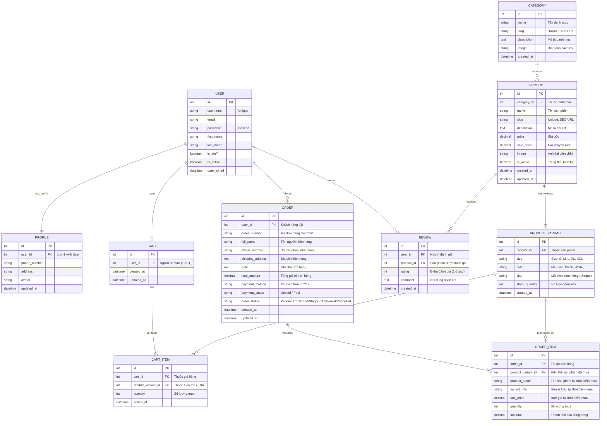

# THIẾT KẾ CƠ SỞ DỮ LIỆU & SƠ ĐỒ THỰC THỂ LIÊN KẾT (ERD)

---

## 1. SƠ ĐỒ THỰC THỂ LIÊN KẾT (MERMAID ERD DIAGRAM)

---

## 2. CHI TIẾT CÁC THỰC THỂ VÀ MÔ HÌNH DỮ LIỆU (DATA MODEL SPECIFICATIONS)

### 2.1. Thực thể `User` & `Profile`
- **User (Mặc định của Django):**
  - Quản lý định danh tài khoản, mật khẩu đã mã hóa, trạng thái phân quyền (`is_staff`, `is_superuser`).
- **Profile (Mở rộng cho Customer):**
  - `user`: Khóa ngoại `OneToOneField(User, on_delete=models.CASCADE)`. Khi tài khoản User bị xóa, Profile tương ứng sẽ tự động bị xóa theo.
  - `phone_number`: Chuỗi ký tự (CharField tối đa 15 ký tự), lưu số điện thoại giao hàng.
  - `address`: Chuỗi văn bản (CharField / TextField), lưu địa chỉ mặc định của khách hàng.
  - `avatar`: ImageField (tùy chọn) lưu ảnh đại diện.

### 2.2. Thực thể `Category` (Danh mục sản phẩm)
- `name`: Tên danh mục (ví dụ: "Áo sơ mi", "Quần Jeans", "Áo thun"), CharField(max_length=100), `unique=True`.
- `slug`: Chuỗi định danh URL thân thiện (ví dụ: `ao-so-mi`), SlugField, `unique=True`.
- `description`: Mô tả ngắn về danh mục, TextField(blank=True).
- `image`: Ảnh bìa của danh mục, ImageField(upload_to='categories/').
- `created_at`: Thời gian tạo danh mục, DateTimeField(auto_now_add=True).

### 2.3. Thực thể `Product` (Sản phẩm)
- `category`: `ForeignKey(Category, on_delete=models.CASCADE, related_name='products')`. Khi một danh mục bị xóa, các sản phẩm thuộc danh mục đó sẽ được xử lý đồng bộ.
- `name`: Tên sản phẩm thời trang (ví dụ: "Áo Sơ Mi Oxford Slim-Fit"), CharField(max_length=200).
- `slug`: Đường dẫn URL chuẩn SEO, SlugField(max_length=250, unique=True).
- `description`: Chi tiết chất liệu, hướng dẫn giặt ủi, thông tin kiểu dáng, TextField.
- `price`: Giá niêm yết gốc của sản phẩm, DecimalField(max_digits=10, decimal_places=0) (phù hợp định dạng tiền VNĐ).
- `sale_price`: Giá bán ưu đãi (nếu có khuyến mãi), DecimalField(max_digits=10, decimal_places=0, null=True, blank=True).
- `image`: Hình ảnh chính của sản phẩm, ImageField(upload_to='products/').
- `is_active`: Trạng thái bật/tắt hiển thị sản phẩm trên trang chủ và danh sách, BooleanField(default=True).
- `created_at` & `updated_at`: Thời điểm tạo và cập nhật gần nhất.

### 2.4. Thực thể `ProductVariant` (Biến thể sản phẩm - Kích cỡ & Màu sắc)
- `product`: `ForeignKey(Product, on_delete=models.CASCADE, related_name='variants')`.
- `size`: Kích cỡ sản phẩm, CharField(max_length=10, choices=[('S','S'), ('M','M'), ('L','L'), ('XL','XL'), ('XXL','XXL')]).
- `color`: Màu sắc sản phẩm, CharField(max_length=50) (ví dụ: "Trắng", "Đen", "Xanh Navy", "Be").
- `sku`: Mã định danh kho riêng biệt cho từng size/màu (ví dụ: `FS-OXF-WHT-M`), CharField(max_length=50, unique=True).
- `stock_quantity`: Số lượng tồn kho thực tế của size và màu đó, IntegerField(default=0). Ràng buộc giá trị không được âm (`>= 0`).

### 2.5. Thực thể `Cart` & `CartItem` (Giỏ hàng)
- **Cart:**
  - `user`: `OneToOneField(User, on_delete=models.CASCADE, related_name='cart')`. Mỗi người dùng sở hữu duy nhất 1 giỏ hàng hoạt động.
  - `created_at`, `updated_at`: Theo dõi thời điểm tạo và cập nhật.
- **CartItem:**
  - `cart`: `ForeignKey(Cart, on_delete=models.CASCADE, related_name='items')`.
  - `product_variant`: `ForeignKey(ProductVariant, on_delete=models.CASCADE)`. Trỏ chính xác đến kích cỡ và màu sắc mà khách muốn mua.
  - `quantity`: Số lượng món hàng, PositiveIntegerField(default=1).
  - Ràng buộc độc nhất (Unique Together): `['cart', 'product_variant']` đảm bảo không bị tạo 2 dòng trùng lặp cho cùng một biến thể trong cùng một giỏ hàng (nếu thêm tiếp thì tăng số lượng).

### 2.6. Thực thể `Order` & `OrderItem` (Đơn hàng & Dòng đơn hàng)
- **Order:**
  - `user`: `ForeignKey(User, on_delete=models.SET_NULL, null=True, related_name='orders')`. Nếu tài khoản khách bị xóa, dữ liệu lịch sử bán hàng vẫn được bảo toàn cho cửa hàng.
  - `order_number`: Mã đơn hàng duy nhất dạng ngẫu nhiên/chuỗi (ví dụ: `FS-20261030-9821`), CharField(max_length=50, unique=True).
  - `full_name`: Họ tên người nhận hàng khi đặt, CharField(max_length=100).
  - `phone_number`: Số điện thoại người nhận hàng, CharField(max_length=15).
  - `shipping_address`: Địa chỉ giao hàng chi tiết, TextField().
  - `note`: Ghi chú giao hàng (ví dụ: "Giao giờ hành chính"), TextField(blank=True).
  - `total_amount`: Tổng giá trị tiền của đơn hàng, DecimalField(max_digits=12, decimal_places=0).
  - `payment_method`: CharField(max_length=20, default='COD', choices=[('COD', 'Thanh toán khi nhận hàng')]).
  - `payment_status`: CharField(max_length=20, default='Unpaid', choices=[('Unpaid', 'Chưa thanh toán'), ('Paid', 'Đã thanh toán')]).
  - `order_status`: Trạng thái xử lý của đơn hàng, CharField(max_length=20, default='Pending', choices=[('Pending', 'Chờ xử lý'), ('Confirmed', 'Đã xác nhận'), ('Shipping', 'Đang giao hàng'), ('Delivered', 'Đã giao thành công'), ('Cancelled', 'Đã hủy')]).
  - `created_at` & `updated_at`: Quản lý thời gian đặt hàng và xử lý.
- **OrderItem:**
  - `order`: `ForeignKey(Order, on_delete=models.CASCADE, related_name='items')`.
  - `product_variant`: `ForeignKey(ProductVariant, on_delete=models.SET_NULL, null=True)`.
  - `product_name`: Tên sản phẩm sao lưu nguyên vẹn tại thời điểm đặt, CharField(max_length=200).
  - `variant_info`: Chuỗi thông tin "Size: M, Màu: Trắng" lưu cứng lại, phòng trường hợp biến thể sau này đổi mã SKU.
  - `unit_price`: Đơn giá tại thời điểm mua (bảo toàn giá trị mua), DecimalField(max_digits=10, decimal_places=0).
  - `quantity`: Số lượng mua, PositiveIntegerField().
  - `subtotal`: Thành tiền (`unit_price * quantity`), DecimalField(max_digits=12, decimal_places=0).

### 2.7. Thực thể `Review` (Đánh giá & Nhận xét)
- `product`: `ForeignKey(Product, on_delete=models.CASCADE, related_name='reviews')`.
- `user`: `ForeignKey(User, on_delete=models.CASCADE)`.
- `rating`: Điểm đánh giá, IntegerField(choices=[(1, '1 Sao'), (2, '2 Sao'), (3, '3 Sao'), (4, '4 Sao'), (5, '5 Sao')]).
- `comment`: Nội dung đánh giá của khách hàng, TextField().
- `created_at`: Thời gian gửi đánh giá.

---

## 3. GIẢI THÍCH MỐI QUAN HỆ & HÀNH VI XÓA (RELATIONSHIPS & ON_DELETE BEHAVIORS)

| Mối quan hệ | Loại quan hệ | Hành vi xóa (`on_delete`) | Giải thích lý do nghiệp vụ |
| :--- | :--- | :--- | :--- |
| `User` → `Profile` | 1 - 1 | `CASCADE` | Khi một tài khoản bị xóa hoàn toàn khỏi hệ thống, hồ sơ cá nhân phụ trợ cũng không cần giữ lại. |
| `Category` → `Product` | 1 - N | `CASCADE` | Một danh mục có nhiều sản phẩm. Xóa danh mục sẽ xóa các sản phẩm trực thuộc (hoặc trong thực tế có thể dùng `PROTECT` để ngăn xóa nếu còn sản phẩm). |
| `Product` → `ProductVariant` | 1 - N | `CASCADE` | Các biến thể (size, màu) gắn liền với sản phẩm; xóa sản phẩm mẹ thì tất cả biến thể của nó tự động bị xóa theo. |
| `User` → `Cart` | 1 - 1 | `CASCADE` | Giỏ hàng gắn với tài khoản; tài khoản mất thì giỏ hàng cũng được dọn dẹp khỏi database. |
| `Cart` → `CartItem` | 1 - N | `CASCADE` | Xóa giỏ hàng sẽ xóa tất cả các món đồ bên trong giỏ. |
| `ProductVariant` → `CartItem` | 1 - N | `CASCADE` | Nếu một biến thể sản phẩm bị xóa khỏi kho, mục đó trong giỏ hàng của khách cũng sẽ tự động được dọn dẹp. |
| `User` → `Order` | 1 - N | `SET_NULL` | Nếu người dùng xóa tài khoản, các đơn hàng họ từng mua trong quá khứ **không bị xóa** nhằm bảo toàn sổ sách doanh thu kế toán cửa hàng. |
| `Order` → `OrderItem` | 1 - N | `CASCADE` | Đơn hàng bị hủy/xóa thì toàn bộ các dòng chi tiết món đồ của đơn hàng đó sẽ bị xóa theo. |
| `ProductVariant` → `OrderItem` | 1 - N | `SET_NULL` | Nếu sau này sản phẩm biến thể bị ngừng bán hoặc xóa khỏi kho, lịch sử đơn hàng cũ vẫn còn nguyên thông tin đã lưu trữ trong các trường `product_name`, `variant_info`, `unit_price`. |
| `Product` → `Review` | 1 - N | `CASCADE` | Xóa sản phẩm sẽ xóa tất cả các bình luận/đánh giá liên quan đến sản phẩm đó. |
| `User` → `Review` | 1 - N | `CASCADE` | Người dùng bị xóa sẽ xóa các đánh giá tương ứng. |
