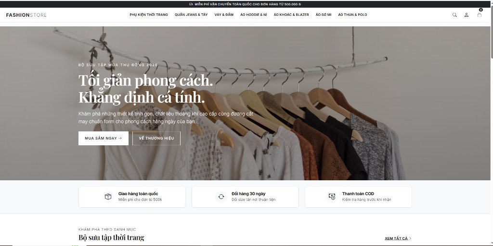
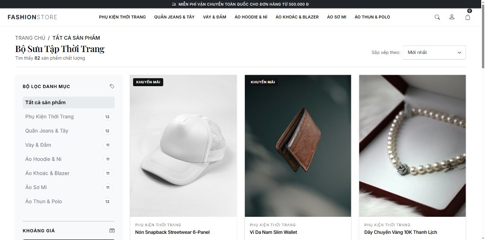
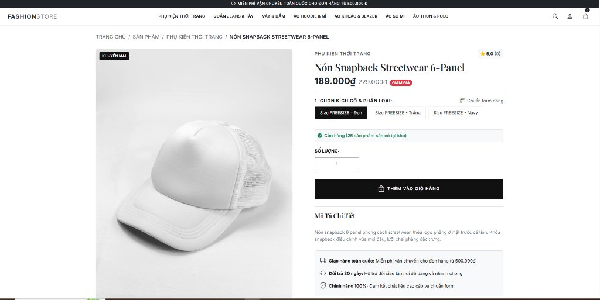
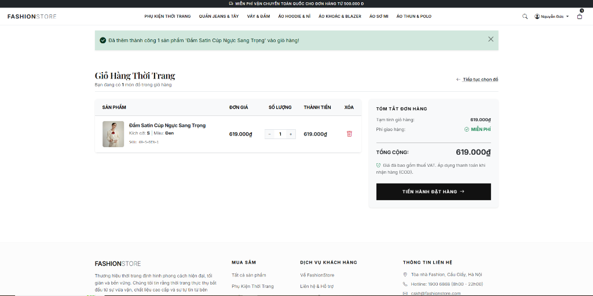
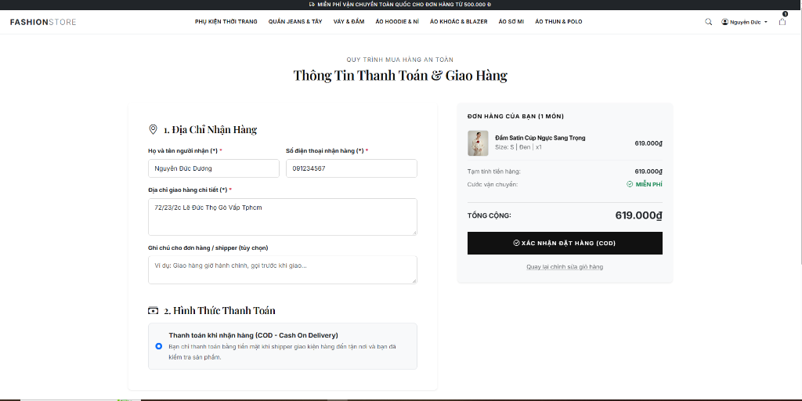
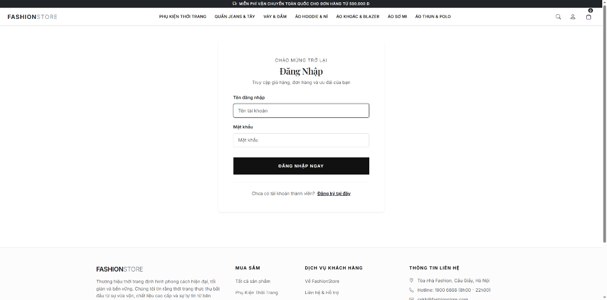
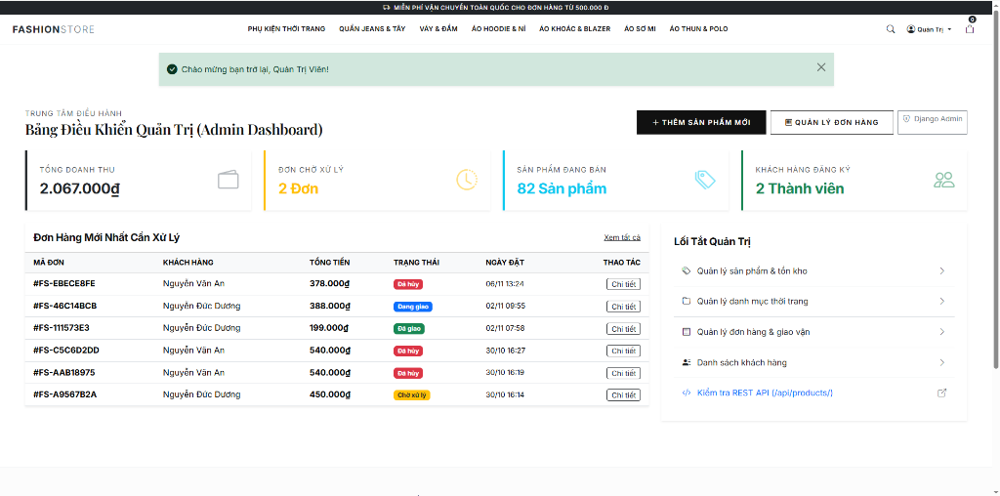
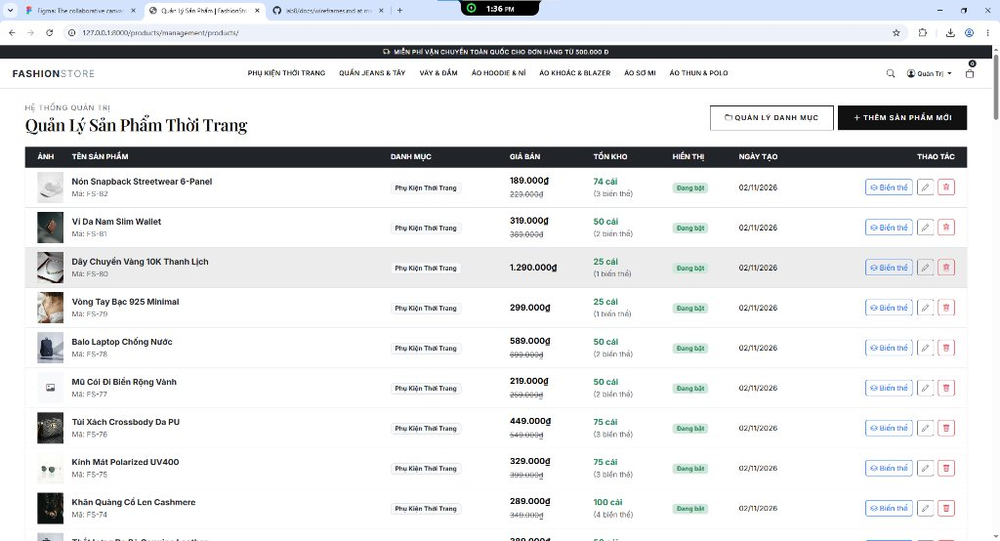

# THIẾT KẾ BỐ CỤC VÀ KHUNG GIAO DIỆN (UI & WIREFRAME DESIGNS)

---

## 1. NGUYÊN TẮC THIẾT KẾ THỜI TRANG (FASHION STORE DESIGN PHILOSOPHY)
- **Cảm hứng thiết kế:** Phong cách tối giản (Minimalism) hiện đại theo tiêu chuẩn của các thương hiệu thời trang cao cấp quốc tế (Zara, Uniqlo, Mango, Routine).
- **Hệ màu chủ đạo (Color Palette):**
  - **Nền chính (Background):** Trắng tuyết `#FFFFFF` và xám khói `#F8F9FA`.
  - **Màu chữ & Đường nét:** Đen tuyền `#111111` và xám trung tính `#495057`.
  - **Điểm nhấn tương phản (Accents):** Tông màu đen huyền bí kết hợp badge đỏ/đen nổi bật cho nhãn `KHUYẾN MÃI` và `GIẢM GIÁ`.
- **Typography:** Font chữ không chân (Sans-serif) thanh lịch, phân cấp thị giác rõ ràng giữa Tiêu đề (Headings), Thẻ phân loại và Giá tiền VNĐ.
- **Tối ưu hiển thị hình ảnh:** Khung hình chuẩn tỷ lệ 1:1 và 3:4, độ phân giải cao, hỗ trợ bo góc nhẹ và hiệu ứng hover tương tác mượt mà.

---

## 2. GIAO DIỆN THỰC TẾ VÀ ĐẶC TẢ BỐ CỤC CÁC TRANG CHÍNH

### 2.1. TRANG CHỦ (HOMEPAGE)

**Đặc tả thành phần & Bố cục:**
- **Thanh thông báo tiện ích (Top Banner):** Thông điệp cam kết miễn phí vận chuyển toàn quốc cho đơn hàng từ 500.000₫.
- **Thanh điều hướng toàn diện (Header Navigation & Mega Menu):** Logo thương hiệu `FASHIONSTORE` phong cách Typographic, liên kết điều hướng 7 danh mục thời trang chính, công cụ tìm kiếm, tài khoản người dùng và giỏ hàng với huy hiệu số lượng realtime.
- **Hero Banner:** Trình diễn bộ sưu tập Thu Đông 2026, câu slogan định vị *"Tối giản phong cách. Khẳng định cá tính"* cùng hai nút kêu gọi hành động (CTA): `MUA SẮM NGAY` và `VỀ THƯƠNG HIỆU`.
- **Khối giá trị cốt lõi (USP Badges):** 3 cam kết dịch vụ nổi bật: Giao hàng toàn quốc (Free > 500k), Đổi hàng 30 ngày tận nơi thuận tiện, Thanh toán COD kiểm tra hàng trước khi nhận.

---

### 2.2. TRANG DANH SÁCH SẢN PHẨM (PRODUCT LISTING / CATALOG)

**Đặc tả thành phần & Bố cục:**
- **Thanh điều hướng phân cấp (Breadcrumbs):** Hiển thị rõ đường dẫn duyệt web: `Trang chủ / Tất cả sản phẩm`.
- **Tiêu đề phân hệ & Số liệu:** Tiêu đề bộ sưu tập kèm tổng số lượng sản phẩm tìm thấy trong hệ thống (`82 sản phẩm chất lượng`).
- **Bộ lọc đa năng bên trái (Left Sidebar Filter):**
  - Lọc theo từng danh mục cụ thể kèm huy hiệu số lượng tồn (Phụ Kiện, Quần Jeans, Váy Đầm, Hoodie, Áo Khoác, Sơ Mi, Áo Thun).
  - Bộ lọc khoảng giá linh hoạt.
- **Lưới hiển thị sản phẩm (Responsive Grid):** Thẻ sản phẩm chuẩn tỷ lệ 3:4, nhãn ưu đãi `KHUYẾN MÃI` góc trái, hiển thị ảnh đại diện, danh mục phân cấp và tên sản phẩm.
- **Bộ sắp xếp nhanh (Sort Dropdown):** Cho phép sắp xếp theo Mới nhất, Giá tăng dần, Giá giảm dần.

---

### 2.3. TRANG CHI TIẾT SẢN PHẨM & BIẾN THỂ (PRODUCT DETAIL & VARIANTS)

**Đặc tả thành phần & Bố cục:**
- **Khung trưng bày hình ảnh lớn:** Ảnh sản phẩm độ phân giải cao, hỗ trợ zoom chi tiết chất liệu và đường may.
- **Khu vực thông tin giá & ưu đãi:** Giá bán chính thức định dạng VNĐ chuẩn (`189.000₫`), giá gốc gạch ngang (`229.000₫`) và nhãn đỏ `GIẢM GIÁ`.
- **Bộ chọn biến thể trực quan (Variants Selector):**
  - Các nút kích cỡ & màu sắc thiết kế dạng button trực quan: `Size FREESIZE - Đen`, `Size FREESIZE - Trắng`, `Size FREESIZE - Navy`.
  - Tự động kiểm tra và phản hồi số lượng tồn kho tức thì: `Còn hàng (25 sản phẩm sẵn có tại kho)`.
- **Khối thao tác mua sắm:** Ô nhập số lượng tùy chỉnh, nút bấm nổi bật `THÊM VÀO GIỎ HÀNG` tích hợp AJAX phản hồi không cần tải lại trang.
- **Mô tả chi tiết & Cam kết chất lượng:** Thông tin nguồn gốc, kiểu dáng, form mẫu, kèm 3 thẻ bảo đảm chính hãng 100%, đổi trả trong 30 ngày và freeship.

---

### 2.4. TRANG GIỎ HÀNG THỜI TRANG (SHOPPING CART)

**Đặc tả thành phần & Bố cục:**
- **Thông báo trạng thái (Alert Notification):** Thanh thông báo nền xanh xác nhận hành động thêm sản phẩm vào giỏ thành công.
- **Bảng chi tiết các món trong giỏ (Cart Table):**
  - Cột sản phẩm: Ảnh thu nhỏ, tên sản phẩm, thông tin biến thể cụ thể (Kích cỡ: S, Màu: Đen, Mã kho SKU: `68-S-DEN-1`).
  - Cột đơn giá: Định dạng chuẩn tiền tệ Việt Nam.
  - Cột số lượng: Nút tăng giảm số lượng (+ / -) tương tác nhanh.
  - Cột thành tiền và nút Xóa biểu tượng thùng rác màu đỏ.
- **Thẻ tóm tắt đơn hàng (Order Summary Card):** Tạm tính giá trị giỏ hàng, cước vận chuyển (Tự động hiển thị `MIỄN PHÍ` khi đạt mốc ưu đãi), tổng cộng thanh toán cuối cùng và nút lớn `TIẾN HÀNH ĐẶT HÀNG ->`.

---

### 2.5. TRANG ĐẶT HÀNG & THANH TOÁN (CHECKOUT & PAYMENT)

**Đặc tả thành phần & Bố cục:**
- **Tiêu đề bảo mật:** `QUY TRÌNH MUA HÀNG AN TOÀN - Thông Tin Thanh Toán & Giao Hàng`.
- **Phân vùng 1: Địa chỉ nhận hàng (Shipping Address):**
  - Họ và tên người nhận (*).
  - Số điện thoại nhận hàng chuẩn 10 chữ số (*).
  - Địa chỉ giao hàng chi tiết (*).
  - Ghi chú giao hàng linh hoạt cho shipper.
- **Phân vùng 2: Hình thức thanh toán (Payment Method):**
  - Lựa chọn phương thức thanh toán khi nhận hàng (COD - Cash On Delivery) với hướng dẫn rõ ràng: kiểm tra kiện hàng trước khi thanh toán.
- **Tóm tắt đơn hàng bên phải:** Danh sách các món chuẩn bị xuất kho kèm ảnh, số lượng, tổng thanh toán và nút `XÁC NHẬN ĐẶT HÀNG (COD)`.

---

### 2.6. TRANG ĐĂNG KÝ & ĐĂNG NHẬP (AUTH PAGES)

**Đặc tả thành phần & Bố cục:**
- **Thẻ xác thực tập trung (Centered Card):** Bố cục tối giản, phân cấp typography rõ ràng với lời chào *"Chào mừng trở lại - Đăng Nhập"*.
- **Các trường nhập liệu an toàn:**
  - Tên đăng nhập (Username / Email).
  - Mật khẩu với cơ chế mã hóa bảo mật.
- **Nút hành động chính:** Nút đen tràn rộng `ĐĂNG NHẬP NGAY` phong cách tối giản.
- **Điều hướng chuyển đổi:** Liên kết nhanh `Đăng ký tại đây` dành cho khách hàng mới chưa có tài khoản.

---

### 2.7. BẢNG ĐIỀU KHIỂN QUẢN TRỊ (ADMIN DASHBOARD)

**Đặc tả thành phần & Bố cục:**
- **Lời chào phân quyền:** Huy hiệu xanh thông báo *"Chào mừng bạn trở lại, Quản Trị Viên!"*.
- **4 Thẻ số liệu chỉ số kinh doanh then chốt (KPI Cards):**
  - **Tổng doanh thu:** Tự động tính toán tổng số tiền bán hàng từ các đơn thành công (`2.067.000₫`).
  - **Đơn chờ xử lý:** Thống kê số lượng đơn mới cần duyệt (`2 Đơn`).
  - **Sản phẩm đang bán:** Tổng số lượng mẫu mã đang kinh doanh (`82 Sản phẩm`).
  - **Khách hàng đăng ký:** Số lượng tài khoản người dùng đã kích hoạt (`2 Thành viên`).
- **Bảng danh sách đơn hàng mới nhất:** Hiển thị mã đơn (`#FS-EBECE8FE`, `#FS-46C14BCB`,...), tên khách hàng, tổng tiền, huy hiệu trạng thái màu sắc (`Đã hủy`, `Đang giao`, `Đã giao`, `Chờ xử lý`), ngày đặt và nút xem chi tiết.
- **Lối tắt quản trị nhanh (Quick Navigation):** Truy cập nhanh Quản lý sản phẩm & tồn kho, Quản lý danh mục, Quản lý đơn hàng, Danh sách khách hàng và Kiểm tra REST API.

---

### 2.8. TRANG QUẢN LÝ SẢN PHẨM & BIẾN THỂ (PRODUCT MANAGEMENT)

**Đặc tả thành phần & Bố cục:**
- **Thanh thao tác nghiệp vụ:** Nút `QUẢN LÝ DANH MỤC` và nút nổi bật `+ THÊM SẢN PHẨM MỚI`.
- **Bảng quản trị sản phẩm toàn diện:**
  - **Ảnh đại diện:** Thumbnail sản phẩm thực tế.
  - **Tên & Mã sản phẩm:** Tên sản phẩm kèm mã định danh nội bộ (Mã: `FS-82`, `FS-81`,...).
  - **Danh mục:** Ánh xạ danh mục liên kết.
  - **Giá bán & Giá niêm yết:** Thể hiện cả giá khuyến mãi và giá gốc.
  - **Tồn kho:** Tổng số lượng tồn của sản phẩm kèm số lượng biến thể chi tiết (`74 cái (3 biến thể)`, `50 cái (2 biến thể)`).
  - **Trạng thái hiển thị:** Huy hiệu xanh `Đang bật`.
  - **Hàng nút thao tác:** Nút xem/sửa `Biến thể`, nút Sửa thông tin sản phẩm và nút Xóa có xác nhận an toàn.
